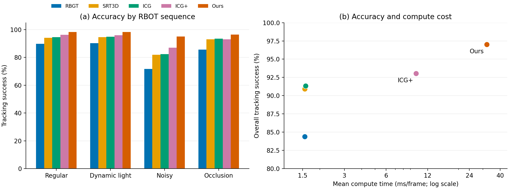

# RBOT数据集五方法评测结果汇总

日期：2026-10-23。依据本次提供的 `summary.json` 和 `results.md`；输入原件已另存并计算SHA256，没有覆盖之前两个工业数据集的结果。

**我们的方法成功率为 97.0292%，相对ICG+提高 3.9736 个百分点，多成功 2,861 帧；计算均值 32.003 ms/帧，计算FPS 31.25。**

## 1. 总体准确率

| 方法 | 评价帧 | 成功帧 | 失败并重置帧 | 成功率 | 位姿重算成功率 | 相对ICG+ / 百分点 |
| --- | --- | --- | --- | --- | --- | --- |
| RBGT | 72,000 | 60,751 | 11,249 | 84.3764% | 84.3764% | -8.6792 |
| SRT3D | 72,000 | 65,455 | 6,545 | 90.9097% | 90.9111% | -2.1458 |
| ICG | 72,000 | 65,754 | 6,246 | 91.3250% | 91.3250% | -1.7306 |
| ICG+ | 72,000 | 67,000 | 5,000 | 93.0556% | 93.0556% | +0.0000 |
| M3T（我们这版） | 72,000 | 69,861 | 2,139 | 97.0292% | 97.0292% | +3.9736 |

相对ICG+，72个配置中我们有 **70个提高、0个持平、2个下降**。失败并重置帧从5,000降至2,139，减少 **57.22%**；这是本协议下的失败计数，不能解释为无真值干预的连续运行可靠性。

## 2. 范围、时间和输入协议

- 全部18个物体×4个序列＝72个目标配置；5方法共360个作业，完整配对。
- 原生640×512 RGB；图像0000仅用于目标真值初始化，0001–1000用于评价；每方法72,000帧。
- 平移误差≤5 cm且旋转误差≤5°成功；失败帧先计入，再按该帧真值重置；评估使用重置前估计。
- 不输入其他物体真值或已知遮挡物模型，不包括额外的modeled-occlusion第五配置。
- ICG表示原版RGB/Region入口；ICG+表示原版Region+ORB入口，JSON内部ID保留icg_rgb和m3t_original_rgb；不把它们写成RGB-D测试。
- 每配置前10个评价帧仅从计时剔除，准确率仍统计；每方法计时71,280帧。单轮运行，固定单线程、软件OpenGL llvmpipe，DISK使用选定GPU。
- 主速度为 `compute_wall_us = tracking_wall_us - decode_us`，包含预测、图像转换/噪声处理、渲染、特征、匹配和优化；不包含读图/PNG解码、误差评价、GT重置、初始化、模型生成、会话加载或写结果。

## 3. 四序列准确率

| 序列 | 评价帧/方法 | RBGT | SRT3D | ICG | ICG+ | M3T（我们这版） | 我们相对ICG+ / 百分点 |
| --- | --- | --- | --- | --- | --- | --- | --- |
| a_regular / 常规 | 18,000 | 89.8111% | 94.1278% | 94.5167% | 96.2167% | 98.2722% | +2.0556 |
| b_dynamiclight / 动态光照 | 18,000 | 90.2778% | 94.5667% | 94.8833% | 95.9722% | 98.2333% | +2.2611 |
| c_noisy / 噪声 | 18,000 | 71.7833% | 81.9556% | 82.3333% | 86.9667% | 95.1056% | +8.1389 |
| d_occlusion / 遮挡 | 18,000 | 85.6333% | 92.9889% | 93.5667% | 93.0667% | 96.5056% | +3.4389 |

最大增益来自c_noisy：+8.1389个百分点，多成功1,465帧。该观察只能说明整套方法在此子集受益较大；尚不能把增益全部归给去噪、DISK或时序模块，需同一代码基底的消融。

## 4. 18个物体的四序列平均

| 物体 | RBGT | SRT3D | ICG | ICG+ | M3T（我们这版） | 我们相对ICG+ / 百分点 |
| --- | --- | --- | --- | --- | --- | --- |
| ape | 93.9500% | 98.1750% | 97.8000% | 98.4250% | 98.4500% | +0.0250 |
| bakingsoda | 51.5500% | 64.7500% | 65.8750% | 78.8250% | 94.2500% | +15.4250 |
| benchviseblue | 95.7000% | 98.0500% | 98.5000% | 97.8500% | 99.8750% | +2.0250 |
| broccolisoup | 92.1750% | 95.8250% | 95.3750% | 96.5000% | 98.4750% | +1.9750 |
| cam | 85.0500% | 93.5000% | 93.7750% | 95.2500% | 98.4500% | +3.2000 |
| can | 84.2500% | 90.7500% | 91.1000% | 90.6750% | 97.8000% | +7.1250 |
| cat | 98.7500% | 99.7250% | 99.8750% | 99.6750% | 99.8250% | +0.1500 |
| clown | 91.3750% | 96.0500% | 96.4750% | 97.0000% | 99.2250% | +2.2250 |
| cube | 78.0000% | 84.4250% | 86.4750% | 96.7500% | 97.9750% | +1.2250 |
| driller | 89.4250% | 94.8000% | 95.0750% | 94.2250% | 98.2000% | +3.9750 |
| duck | 90.7750% | 97.0250% | 97.3000% | 96.6250% | 98.6000% | +1.9750 |
| eggbox | 77.9250% | 87.6500% | 88.1000% | 85.9000% | 95.4250% | +9.5250 |
| glue | 62.0750% | 71.7250% | 73.6250% | 77.5000% | 83.9750% | +6.4750 |
| iron | 85.6250% | 92.4750% | 92.8750% | 91.4750% | 95.4000% | +3.9250 |
| koalacandy | 73.1500% | 87.7500% | 88.1750% | 95.2750% | 97.7000% | +2.4250 |
| lamp | 85.7500% | 91.6500% | 91.0750% | 90.6500% | 97.4500% | +6.8000 |
| phone | 84.5750% | 92.4750% | 92.7500% | 93.2500% | 95.5250% | +2.2750 |
| squirrel | 98.6750% | 99.5750% | 99.6250% | 99.1500% | 99.9250% | +0.7750 |

四序列合并后，18个物体上我们均高于ICG+。glue仍只有83.9750%，是当前主要难点之一；“每个物体平均更好”不代表每个单独配置都最好。

## 5. 每帧计算耗时

| 方法 | 计时帧 | 均值 ms | 中位数 ms | P95 ms | 计算FPS |
| --- | --- | --- | --- | --- | --- |
| RBGT | 71,280 | 1.552 | 1.381 | 2.778 | 644.38 |
| SRT3D | 71,280 | 1.551 | 1.356 | 2.827 | 644.79 |
| ICG | 71,280 | 1.573 | 1.382 | 2.831 | 635.64 |
| ICG+ | 71,280 | 9.893 | 8.045 | 21.408 | 101.08 |
| M3T（我们这版） | 71,280 | 32.003 | 31.351 | 58.767 | 31.25 |

我们的均值为ICG+的 **3.235倍**。平均31.25计算FPS不能等价为稳定30 Hz实时系统：本轮计算P95为58.767 ms，且这里不包含输入读取、输出显示和失败重置。速度是本次共享服务器负载下的单轮实测，论文正式计时应另做固定条件重复。

原生cycle的阶段划分按方法不同，只用于定位各自热点；不取代上表统一计算耗时。

| 阶段 | ICG+ ms | 我们 ms |
| --- | --- | --- |
| 对应关系 | 3.387 | 24.198 |
| 梯度/Hessian | 0.373 | 0.445 |
| 优化 | 0.049 | 0.199 |
| 结果/关键帧维护 | 6.072 | 7.116 |

我们对应关系阶段约24.198 ms，占原生cycle约75.72%；其中包含CAD渲染、图像读回、DISK提取、匹配与RANSAC等，现有统计不能进一步断言全部时间都消耗在神经网络。预处理均值约0.383 ms。

## 6. 审计、例外和旧结果对照

所有方法无效估计均为0。360个作业的帧数、成功/失败计数、分组聚合、配对表和源Markdown的360个配置成功率单元格均已交叉核验。没有收到逐帧CSV，因此本次核验不能代替服务器逐帧位姿重算。

| 方法/配置 | 图像索引 | 原生成功率 | 重算成功率 |
| --- | --- | --- | --- |
| SRT3D / d_occlusion__ape | 578 | 97.5000% | 97.6000% |

SRT3D有1帧的原生与重算分类不同，总体分别为90.9097%和90.9111%。主表保留控制实际重置轨迹的原生口径；这1帧差异的具体数值原因仍需对应CSV，不能直接推定为阈值边界误差。

我们不优于ICG+的两项为b_dynamiclight/cat（99.9%对100.0%）与c_noisy/ape（97.3%对98.2%）。此外c_noisy/cat、d_occlusion/cat、d_occlusion/eggbox、d_occlusion/iron也低于其余方法中的最佳值，应保留为失败分析。

旧轮我们为97.0708%，本轮97.0292%，相差-0.0417个百分点（对应相同分母少30个成功帧）。旧轮没有统一计算计时，新轮关闭额外诊断并使用不同评测壳/有限数值保护；这不是独立消融，不能将差值归因给某个算法模块，也不替换本轮完整配对结果。

按物体聚类、四序列共同重采样的描述性bootstrap：增益均值+3.9736个百分点，95%百分位区间[+2.4069, +5.8709]；18个聚类、20,000次、种子20261023。该区间反映本组物体抽样差异，不使用72,000帧作为独立样本，也不是新工位泛化保证。

## 7. 与已完成两套工业数据的结果并列

| 数据集 | 配置/方法 | RBGT | SRT3D | ICG | ICG+ | M3T（我们这版） | 我们相对ICG+ / 百分点 |
| --- | --- | --- | --- | --- | --- | --- | --- |
| RBOT | 72 | 84.3764% | 90.9097% | 91.3250% | 93.0556% | 97.0292% | +3.9736 |
| 工业基础集（上一轮完整集） | 150 | 61.3146% | 73.8063% | 74.2151% | 82.2017% | 85.4041% | +3.2024 |
| 工业进阶集v1.0 | 324 | 78.4099% | 87.5455% | 88.2029% | 89.3280% | 92.8852% | +3.5571 |

| 数据集 | RBGT 计算ms | SRT3D 计算ms | ICG 计算ms | ICG+ 计算ms | M3T（我们这版） 计算ms |
| --- | --- | --- | --- | --- | --- |
| RBOT | 1.552 | 1.551 | 1.573 | 9.893 | 32.003 |
| 工业基础集 | 1.405 | 1.441 | 1.490 | 4.449 | 13.530 |
| 工业进阶集 | 1.817 | 1.853 | 1.891 | 6.074 | 17.764 |

三套数据分别支持“公共基准、工业外观/运动、受控困难条件”的验证。分辨率、对象和场景复杂度不同，服务器运行负载也不同，不拼成一个总成功率或用跨数据集时间变化证明加速。两套自渲染集和RBOT仍不足以替代真实工件下游实验。

## 8. 图与运行身份

图中速度使用统一计算耗时，右图横轴为对数轴；准确率为单轮完整GT-reset协议结果。SVG同名文件可用于后续排版。

- 服务器运行目录：`/home/jyj/autodl-tmp/M3T-RBOT-comparison-runs/full_20261022T124916Z_1164394`。
- GPU UUID：`GPU-b99eeb81-6360-897a-d3b1-6ed836487d11`。
- 输入指纹：`44e8eec60ff5fcb857c714d7b11fae498614bde01fe4641759c001762792bea1`。
- 原件与本地复核记录：`C:\Users\jinyongji111\.codex\visualizations\2026\10\14\01a13a69-8300-7c50-b968-cf12aeffb116\rbot-five-methods-20261023`。

## 附录：18物体×4序列，五方法全部配对

| 物体 | 序列 | RBGT | SRT3D | ICG | ICG+ | M3T（我们这版） | 我们相对ICG+ / 百分点 |
| --- | --- | --- | --- | --- | --- | --- | --- |
| ape | a_regular | 96.4000% | 98.5000% | 98.6000% | 98.9000% | 99.4000% | +0.5000 |
| ape | b_dynamiclight | 96.4000% | 99.0000% | 98.5000% | 99.4000% | 99.6000% | +0.2000 |
| ape | c_noisy | 92.0000% | 97.7000% | 97.2000% | 98.2000% | 97.3000% | -0.9000 |
| ape | d_occlusion | 91.0000% | 97.5000% | 96.9000% | 97.2000% | 97.5000% | +0.3000 |
| bakingsoda | a_regular | 53.2000% | 65.2000% | 67.5000% | 85.0000% | 97.3000% | +12.3000 |
| bakingsoda | b_dynamiclight | 53.1000% | 65.6000% | 66.1000% | 80.0000% | 94.8000% | +14.8000 |
| bakingsoda | c_noisy | 50.7000% | 62.7000% | 63.2000% | 74.3000% | 90.9000% | +16.6000 |
| bakingsoda | d_occlusion | 49.2000% | 65.5000% | 66.7000% | 76.0000% | 94.0000% | +18.0000 |
| benchviseblue | a_regular | 98.5000% | 99.2000% | 99.5000% | 99.3000% | 99.9000% | +0.6000 |
| benchviseblue | b_dynamiclight | 98.4000% | 99.3000% | 99.6000% | 99.0000% | 100.0000% | +1.0000 |
| benchviseblue | c_noisy | 90.4000% | 95.1000% | 95.7000% | 95.2000% | 100.0000% | +4.8000 |
| benchviseblue | d_occlusion | 95.5000% | 98.6000% | 99.2000% | 97.9000% | 99.6000% | +1.7000 |
| broccolisoup | a_regular | 93.8000% | 96.6000% | 95.3000% | 97.5000% | 98.7000% | +1.2000 |
| broccolisoup | b_dynamiclight | 93.8000% | 96.1000% | 95.7000% | 97.0000% | 98.8000% | +1.8000 |
| broccolisoup | c_noisy | 92.0000% | 95.6000% | 95.7000% | 96.2000% | 98.5000% | +2.3000 |
| broccolisoup | d_occlusion | 89.1000% | 95.0000% | 94.8000% | 95.3000% | 97.9000% | +2.6000 |
| cam | a_regular | 93.3000% | 97.4000% | 97.4000% | 98.8000% | 99.7000% | +0.9000 |
| cam | b_dynamiclight | 92.1000% | 97.7000% | 97.5000% | 97.6000% | 99.2000% | +1.6000 |
| cam | c_noisy | 68.6000% | 83.7000% | 85.3000% | 90.8000% | 97.4000% | +6.6000 |
| cam | d_occlusion | 86.2000% | 95.2000% | 94.9000% | 93.8000% | 97.5000% | +3.7000 |
| can | a_regular | 91.8000% | 96.0000% | 96.7000% | 95.0000% | 98.5000% | +3.5000 |
| can | b_dynamiclight | 95.6000% | 97.6000% | 98.2000% | 97.5000% | 99.4000% | +1.9000 |
| can | c_noisy | 59.2000% | 73.9000% | 73.3000% | 78.6000% | 97.0000% | +18.4000 |
| can | d_occlusion | 90.4000% | 95.5000% | 96.2000% | 91.6000% | 96.3000% | +4.7000 |
| cat | a_regular | 99.8000% | 99.7000% | 99.9000% | 99.8000% | 99.9000% | +0.1000 |
| cat | b_dynamiclight | 99.9000% | 99.8000% | 99.9000% | 100.0000% | 99.9000% | -0.1000 |
| cat | c_noisy | 98.9000% | 99.9000% | 99.8000% | 99.5000% | 99.7000% | +0.2000 |
| cat | d_occlusion | 96.4000% | 99.5000% | 99.9000% | 99.4000% | 99.8000% | +0.4000 |
| clown | a_regular | 96.7000% | 98.5000% | 98.5000% | 99.2000% | 99.6000% | +0.4000 |
| clown | b_dynamiclight | 96.5000% | 98.3000% | 98.6000% | 99.1000% | 99.7000% | +0.6000 |
| clown | c_noisy | 80.9000% | 89.6000% | 91.0000% | 92.3000% | 98.5000% | +6.2000 |
| clown | d_occlusion | 91.4000% | 97.8000% | 97.8000% | 97.4000% | 99.1000% | +1.7000 |
| cube | a_regular | 91.8000% | 93.0000% | 95.1000% | 98.6000% | 98.8000% | +0.2000 |
| cube | b_dynamiclight | 92.0000% | 93.2000% | 94.5000% | 98.5000% | 98.6000% | +0.1000 |
| cube | c_noisy | 42.2000% | 60.2000% | 63.5000% | 92.5000% | 97.0000% | +4.5000 |
| cube | d_occlusion | 86.0000% | 91.3000% | 92.8000% | 97.4000% | 97.5000% | +0.1000 |
| driller | a_regular | 92.2000% | 97.6000% | 97.2000% | 97.5000% | 98.7000% | +1.2000 |
| driller | b_dynamiclight | 93.9000% | 97.7000% | 98.0000% | 97.5000% | 99.1000% | +1.6000 |
| driller | c_noisy | 80.3000% | 87.8000% | 88.7000% | 88.1000% | 96.8000% | +8.7000 |
| driller | d_occlusion | 91.3000% | 96.1000% | 96.4000% | 93.8000% | 98.2000% | +4.4000 |
| duck | a_regular | 92.8000% | 97.7000% | 98.5000% | 98.1000% | 99.5000% | +1.4000 |
| duck | b_dynamiclight | 92.5000% | 97.3000% | 97.3000% | 97.6000% | 99.2000% | +1.6000 |
| duck | c_noisy | 92.0000% | 97.5000% | 97.5000% | 96.8000% | 98.3000% | +1.5000 |
| duck | d_occlusion | 85.8000% | 95.6000% | 95.9000% | 94.0000% | 97.4000% | +3.4000 |
| eggbox | a_regular | 88.3000% | 95.0000% | 95.6000% | 93.6000% | 97.9000% | +4.3000 |
| eggbox | b_dynamiclight | 92.9000% | 96.7000% | 97.3000% | 94.6000% | 98.1000% | +3.5000 |
| eggbox | c_noisy | 44.0000% | 63.3000% | 63.3000% | 64.9000% | 90.2000% | +25.3000 |
| eggbox | d_occlusion | 86.5000% | 95.6000% | 96.2000% | 90.5000% | 95.5000% | +5.0000 |
| glue | a_regular | 71.3000% | 79.6000% | 81.3000% | 86.1000% | 87.9000% | +1.8000 |
| glue | b_dynamiclight | 75.9000% | 84.0000% | 86.0000% | 86.2000% | 90.7000% | +4.5000 |
| glue | c_noisy | 32.2000% | 45.2000% | 44.8000% | 55.4000% | 72.6000% | +17.2000 |
| glue | d_occlusion | 68.9000% | 78.1000% | 82.4000% | 82.3000% | 84.7000% | +2.4000 |
| iron | a_regular | 91.5000% | 95.1000% | 96.2000% | 95.1000% | 97.4000% | +2.3000 |
| iron | b_dynamiclight | 90.7000% | 95.9000% | 95.7000% | 95.3000% | 96.8000% | +1.5000 |
| iron | c_noisy | 72.7000% | 84.8000% | 84.2000% | 83.3000% | 92.5000% | +9.2000 |
| iron | d_occlusion | 87.6000% | 94.1000% | 95.4000% | 92.2000% | 94.9000% | +2.7000 |
| koalacandy | a_regular | 79.7000% | 91.1000% | 90.4000% | 96.7000% | 98.3000% | +1.6000 |
| koalacandy | b_dynamiclight | 78.2000% | 90.2000% | 91.7000% | 96.4000% | 98.1000% | +1.7000 |
| koalacandy | c_noisy | 62.5000% | 79.8000% | 80.3000% | 94.0000% | 97.4000% | +3.4000 |
| koalacandy | d_occlusion | 72.2000% | 89.9000% | 90.3000% | 94.0000% | 97.0000% | +3.0000 |
| lamp | a_regular | 95.0000% | 97.8000% | 97.2000% | 95.9000% | 98.9000% | +3.0000 |
| lamp | b_dynamiclight | 94.3000% | 97.8000% | 97.7000% | 96.1000% | 99.3000% | +3.2000 |
| lamp | c_noisy | 61.6000% | 75.2000% | 73.9000% | 78.2000% | 95.2000% | +17.0000 |
| lamp | d_occlusion | 92.1000% | 95.8000% | 95.5000% | 92.4000% | 96.4000% | +4.0000 |
| phone | a_regular | 91.1000% | 96.4000% | 96.6000% | 96.9000% | 98.5000% | +1.6000 |
| phone | b_dynamiclight | 89.6000% | 96.3000% | 95.7000% | 95.9000% | 96.9000% | +1.0000 |
| phone | c_noisy | 73.2000% | 83.8000% | 85.1000% | 87.8000% | 92.6000% | +4.8000 |
| phone | d_occlusion | 84.4000% | 93.4000% | 93.6000% | 92.4000% | 94.1000% | +1.7000 |
| squirrel | a_regular | 99.4000% | 99.9000% | 99.8000% | 99.9000% | 100.0000% | +0.1000 |
| squirrel | b_dynamiclight | 99.2000% | 99.7000% | 99.9000% | 99.8000% | 100.0000% | +0.2000 |
| squirrel | c_noisy | 98.7000% | 99.4000% | 99.5000% | 99.3000% | 100.0000% | +0.7000 |
| squirrel | d_occlusion | 97.4000% | 99.3000% | 99.3000% | 97.6000% | 99.7000% | +2.1000 |
